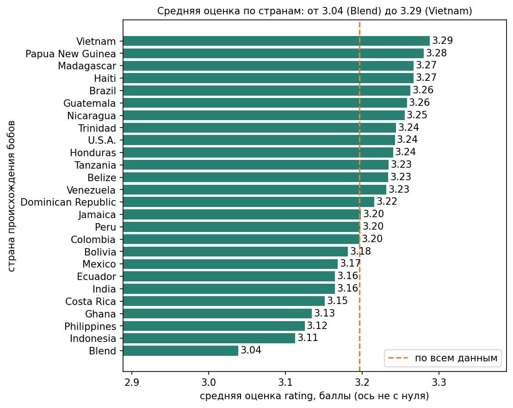
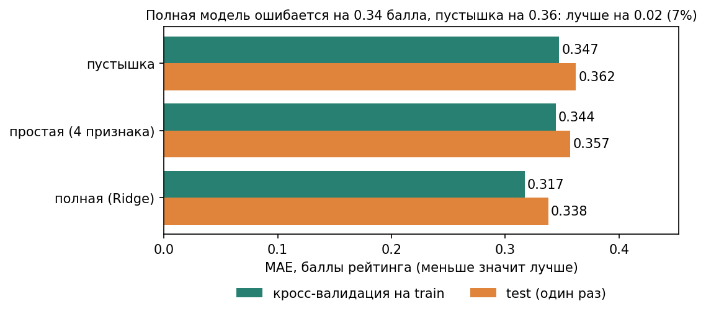

# Какую оценку получит плитка шоколада: от сырых данных к честной модели

**Задача.** Предсказать экспертную оценку плитки шоколада `rating` (от 1 до 4) по производителю, происхождению бобов, проценту какао и составу, до того как плитку попробовали. Регрессия, метрика MAE (средняя абсолютная ошибка в баллах).

**Данные.** Рейтинги шоколада (Flavors of Cacao, TidyTuesday 2022-01-18): https://raw.githubusercontent.com/rfordatascience/tidytuesday/master/data/2022/2022-01-18/chocolate.csv. 2530 строк и 10 столбцов. Одна строка это один экспертный отзыв на одну плитку.

## Что сделано с данными

| шаг | решение | строк |
|---|---|---|
| загрузка | скачали chocolate.csv по ссылке, 10 столбцов | 2530 |
| цель | rating уже число от 1 до 4, преобразование не нужно | 2530 |
| дубли | удалили полные дубли: 0; повторы ref не дубли, это номер записи | 2530 |
| пробелы | убрали лишние пробелы по краям в текстовых столбцах | 2530 |
| невозможные значения | 5 правил (рейтинг 1-4 и кратен 0.25, какао 0-100%, год 2006-2021, пустые названия); удалили строк: 0 | 2530 |
| пропуски: ingredients | не знаем: флаг ingredients_missing (1 у 87 строк), в тексте Unknown | 2530 |
| тип: cocoa_percent | текст '76%' -> число 76.0 | 2530 |
| тип: ingredients | разобрали строку: n_ingredients и 6 флагов; для Unknown n_ingredients = 3 (самое частое) | 2530 |
| столбец ref | удалили: служебный номер записи, не признак | 2530 |
| выбросы | оставили все: значения реальные (какао 42-100%, низкие оценки); логарифм не нужен, хвосты короткие | 2530 |
| clean | собрали все шаги в функцию clean(raw), сторожа assert пройдены | 2530 |
| новые признаки | is_blend, cocoa_dist70, n_additives, made_in_origin: функция add_features, считается по одной строке | 2530 |
| категории | OneHotEncoder(min_frequency=20, редкие в infrequent) для страны и страны компании; компания через TargetEncoder; признаков 59 | 2024 |
| утечка | не берём most_memorable_characteristics (слова после дегустации; MAE 0.318 без слов и 0.259 со словами) и название плитки | 2024 |
| baseline | MAE test: пустышка 0.362, простая 0.357, полная 0.338; test использован один раз | 506 |

## Главное из EDA

* Цель узкая: медиана 3.25, около 86% оценок между 2,75 и 3,75.
* Процент какао связан с оценкой слабо: у плиток 66-75% медиана 3.25, у очень тёмных (больше 80%) 3.0.
* Простые плитки (2-3 ингредиента) оцениваются выше: медиана 3.25 против 3.0 у плиток с 4-5 ингредиентами.
* Состав не записан у 87 плиток, и их средняя оценка ниже: 2.81 против 3.21.
* Средняя оценка по странам происхождения бобов (у стран с 20 и больше плитками) меняется от 3.04 (Blend) до 3.29 (Vietnam).

## Утечка

Какие столбцы не берём и почему:

| столбец | когда становится известен | почему |
|---|---|---|
| specific_bean_origin_or_bar_name | до дегустации | очень много разных значений: почти название-метка, по нему модель запоминает конкретные плитки, а не закономерности |
| most_memorable_characteristics | ПОСЛЕ дегустации | слова, которыми эксперт описал вкус после дегустации: для новой плитки их не существует; проверено моделью |
| ref | служебный номер записи в базе | удалён ещё на этапе 1 |

Проверка моделью: с описанием вкуса от эксперта MAE на кросс-валидации 0.259, без него 0.318.

## Результаты

| модель | MAE на кросс-валидации | MAE на test |
|---|---|---|
| пустышка | 0.347 | 0.362 |
| простая (4 признака) | 0.344 | 0.357 |
| полная (Ridge) | 0.317 | 0.338 |

На test: пустышка 0.362, полная модель (Ridge) 0.338. Модель лучше пустышки на 0.024 балла (7%). Test использован один раз.

## Выводы

1. После очистки 2530 плиток без потерь строк; пропуск состава у 87 плиток это «не знаем», а не «нет».
2. Слова эксперта после дегустации (`most_memorable_characteristics`) подсказывают ответ (MAE 0.318 без них, 0.259 с ними), но для новой плитки их нет, поэтому в модель не идут.
3. Полная модель (Ridge) ошибается на 0.338 балла на test, пустышка на 0.362.
4. Подготовка (медианы, масштаб, редкие страны, код компании) учится только на train внутри `Pipeline`; настройки выбраны кросс-валидацией на train.
5. Дальше: добавить то, чего нет в таблице (сорт и ферментация бобов, обжарка, цена) и проверить модель на отзывах следующих лет.

## Модель

Обученная модель лежит в `model/chocolate_rating_model.joblib`. Чтобы её загрузить, сначала нужно определить функцию `add_features` из тетради (раздел 10), потому что она входит в Pipeline, потом `joblib.load(...)`. Входные столбцы: country_of_bean_origin, company_location, company_manufacturer, cocoa_percent, n_ingredients, review_date, ingredients_missing, has_sugar, has_sweetener, has_cocoa_butter, has_vanilla, has_lecithin, has_salt.

## Как запустить

1. `pip install -r requirements.txt`
2. Открыть `project.ipynb` и выполнить все ячейки (данные скачиваются по ссылке автоматически).
